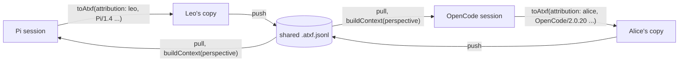

# RFD0001 - Actors and user agents: who wrote each record, and with what

- Feature Name: `actors`
- Status: Draft
- Author: Leo Ostera
- Start Date: 2026-10-31
- Updated: 2026-10-31
- Discussion PR: TBD
- Tracking Issue: TBD

## Summary

ATXF 0.2 adds two optional fields to every record except the header. `actorId` names the person or account on whose
behalf the record was written, such as `leo@ostera.io`. `userAgent` names the software that wrote it, in the style of
an HTTP `User-Agent`, such as `Axo-iPhone/2.3 Pi/1.4 (session 01a189)`. Both are covered by hashes and reconciliation
keys like any other field, so attribution is tamper-evident and the same words from two participants stay two records.
`buildContext` reports each message's attribution and, given the participant it builds context for, shows the model
which messages are its own and who wrote the others. Converters tag the records they read with the local participant.
Shared files and reconciliation (SPEC §18) already let several people and agents continue one session; attribution
makes such a session legible to them and to their models.

## Motivation

ATXF can already hold one session continued by several agents. `@leostera/atxf/sync` reconciles each agent's copy
into a shared file after every turn, and the Pi and OpenCode plugins use it to run one session across both agents.
But a transcript cannot say *who* wrote a record or *with what*. A message has a `role` (`user`, `assistant`, `tool`)
and an `origin.kind` (`human`, `model`, `extension`, ...), and the header's `source.agent` describes the whole file.
None of these names a participant or the software they used.

That gap shows up as soon as a session has two participants:

- **Agents mistake each other's words for their own.** In a live run, Pi answered "pong from pi", OpenCode answered
  "pong from opencode", and Pi was then asked which agent said "pong from opencode". Its model answered that it had
  said it itself. Every assistant message reaches every model as `role: "assistant"`, so each model believes it wrote
  them all. Both agents ran for the same person, so naming the person alone would not have helped: the agents
  themselves must be told apart.
- **People cannot be told apart.** Two people steering one session both write `role: "user"` messages. Neither the
  agents nor a transcript viewer can show who asked for what.
- **No audit trail.** Hashes and seals (SPEC §17) prove that records were not changed, but not who wrote them, so a
  shared transcript cannot answer "who ran this command, through which agent".

Workarounds do not hold up. Putting a name in the message text pollutes the model context and cannot be checked.
Putting attribution in `ext` works per producer, but no consumer can rely on it and `buildContext` cannot act on it.
A per-file default (the header's `source`) is lost when copies are reconciled, because the result keeps one header
(§18).

## Goals

- Every record can say who it was written for and which software wrote it: messages, turns, settings changes, tool
  status, compactions, leaf moves, labels.
- Attribution survives reconciliation, sync, and round trips through every converter.
- Attribution is covered by integrity hashes, so rewriting who said something is as detectable as rewriting what was
  said.
- A model given a multi-participant transcript can tell its own messages from everyone else's, including other agents
  working for the same person, and who wrote them.
- Single-participant transcripts and existing files keep working unchanged.

## Non-goals

- **Authentication.** Attribution is a claim made by whoever wrote the record. Proving it (signatures) is future work;
  see Security.
- **Profiles.** Display names, avatars and roles of people are not part of this RFD. `actorId` is an id only.
- **Permissions.** Who may append to a shared session is decided by whoever controls the file or the sync service.
- **Real-time collaboration.** Live presence, typing indicators and record streaming are separate concerns.

## Guide-level explanation

Every record can carry two things:

- **`actorId`, who.** The person or account accountable for the record, on whose behalf it was written:
  `leo@ostera.io`, `alice`, `svc-nightly-triage`. A person keeps one actor id across devices and agents.
- **`userAgent`, with what.** The software that wrote the record, written like a browser's `User-Agent`: product
  tokens, most significant first, with optional comments. `Axo-iPhone/2.3 Pi/1.4 (session 01a189)` says Pi 1.4 wrote
  it, relayed from Axo on an iPhone, in session `01a189`.

Agents act on someone's behalf, so the records an agent writes carry that person's `actorId` and the agent's
`userAgent`. When Leo asks Pi to fix a build:

- Leo's prompt: `actorId: "leo@ostera.io"`, `userAgent: "Pi/1.4 (session 01a189)"`, `role: "user"`;
- Pi's reply, its tool calls and results, and its turn markers: `actorId: "leo@ostera.io"`,
  `userAgent: "Pi/1.4 (session 01a189)"`.

Whether a person or the model wrote a record is already told by `role` and `origin`, and which model by
`message.model`. So "who ran `rm -rf`?" is answered by "Leo, through Pi 1.4 in session 01a189".

The two fields together identify a **participant**: one agent session acting for one person. The `userAgent` should
name the session in a comment, so that two sessions of the same agent for the same person are different participants.

Both fields are compared, never interpreted. `actorId` is opaque. `userAgent` MAY be parsed to *show* something like
"Pi 1.4 on iPhone", but consumers MUST NOT decide anything based on its contents, a lesson browsers learned the hard
way. A record without them has an unknown author, as in every transcript written before 0.2. Nothing is inherited:
each record names its own attribution, or none.

### Example

Leo prompts Pi; Pi answers. Alice, in OpenCode on the same shared file, asks a follow-up, and OpenCode answers:

```jsonl
{"type":"transcript","atxf":"0.2","id":"s1","time":"2026-10-31T10:00:00Z","source":{"agent":"pi"}}
{"type":"message","id":"m1","parentId":null,"time":"2026-10-31T10:00:01Z","actorId":"leo@ostera.io","userAgent":"Pi/1.4 (session 01a189)","role":"user","content":"Why is the build red?"}
{"type":"message","id":"m2","parentId":"m1","time":"2026-10-31T10:00:09Z","actorId":"leo@ostera.io","userAgent":"Pi/1.4 (session 01a189)","role":"assistant","content":[{"type":"text","text":"The lockfile is stale."}]}
{"type":"message","id":"m3","parentId":"m2","time":"2026-10-31T10:02:00Z","actorId":"alice","userAgent":"OpenCode/2.0.20 (session ses_9)","role":"user","content":"Can you regenerate it?"}
{"type":"message","id":"m4","parentId":"m3","time":"2026-10-31T10:02:20Z","actorId":"alice","userAgent":"OpenCode/2.0.20 (session ses_9)","role":"assistant","content":[{"type":"text","text":"Done."}]}
```

OpenCode builds its model context as its own participant:

```ts
const context = buildContext(transcript, {
  perspective: { actorId: "alice", userAgent: "OpenCode/2.0.20 (session ses_9)" },
});
// context.messages[i].actorId and .userAgent tell who wrote each message, and with what.
// m2 was written by another participant, so the default rendering presents it to the model as attributed input,
// not as something this model said:
//   user:      [leo@ostera.io via Pi/1.4] Why is the build red?
//   user:      [leo@ostera.io via Pi/1.4 (assistant)] The lockfile is stale.
//   user:      Can you regenerate it?
//   assistant: Done.
```

If Leo had joined the same file from OpenCode instead of Alice, his messages would carry the same `actorId` from
both agents. They differ in `userAgent`, so each agent still knows which replies are its own: the case that
motivated this RFD.

Plugins tag records with the local participant when they read their agent's native session:

```ts
const transcript = pi.toAtxf(sessionText, {
  attribution: { actorId: "leo@ostera.io", userAgent: "Pi/1.4 (session 01a189)" },
});
```

The Pi and OpenCode plugins take the person's actor id from configuration (`ATXF_ACTOR_ID`, or a random id kept in
`$XDG_STATE_HOME/atxf/actor-id` so it stays stable) and build the user agent from the agent's name, its version and
the session id. A client that relays input into an agent, such as Axo on an iPhone, can prepend its own product
token.



## Reference-level explanation

### Architecture and boundaries

| Part | Change |
| --- | --- |
| SPEC | Version 0.2. New §3.1 *Attribution*; §5 gains attribution in context; §16 notes the version; §19 notes privacy. |
| Schema | `schema/v0.2`: `actorId` and `userAgent` on the `node` and `annotation` envelopes; header `atxf` is `"0.2"`. |
| `@leostera/atxf` / `atxf` crate | Types; `ContextMessage.actorId` and `.userAgent`; `BuildContextOptions.perspective`; `ConvertOptions.attribution`; validation. |
| Converters | Tag decoded records with `options.attribution`; keep attribution through the carry. |
| Plugins | Configure and pass the local participant; build context with `perspective`. |
| Reconcile, sync, integrity | No algorithm changes. Attribution is ordinary content. |

### Data model and interfaces

**Schema.** Both envelopes gain:

```json
"actorId": {
  "description": "The person or account on whose behalf this record was written. Opaque; compare for equality only.",
  "type": "string",
  "minLength": 1
},
"userAgent": {
  "description": "The software that wrote this record, as product tokens and comments (RFC 9110 User-Agent), most significant first, e.g. `Axo-iPhone/2.3 Pi/1.4 (session 01a189)`. Compare for equality; parse only for display.",
  "type": "string",
  "minLength": 1
}
```

`userAgent` SHOULD follow the RFC 9110 §10.1.5 `User-Agent` grammar: `product[/version]` tokens and parenthesized
comments, separated by spaces. Validators MAY warn about values that do not; they MUST NOT reject them. The header
gets neither field: it describes the transcript, and reconciliation keeps only one header.

**Library (TypeScript; Rust mirrors it).**

```ts
/** One agent session acting for one person: the pair of a record's `actorId` and `userAgent`. */
interface Participant {
  actorId?: string;
  userAgent?: string;
}

interface ContextMessage {
  body: MessageBody;
  sourceId: string;
  kind: ContextMessageKind;
  /** The attribution of the record the message comes from, when it has any. */
  actorId?: string;
  userAgent?: string;
}

interface BuildContextOptions {
  // ...existing options
  /** The participant this context is built for. Renderers use it to tell its own messages from others'. */
  perspective?: Participant;
}

interface ConvertOptions {
  integrity?: boolean;
  /**
   * Attribution for records read from native files that have none. Records in a carried transcript keep the
   * attribution they have.
   */
  attribution?: Participant;
}
```

For summary messages that `buildContext` synthesizes (§5 step 3), the attribution is that of the compaction or
`branch_summary` record they come from. For a `context_edit` replacement, the message keeps its target's attribution;
the edit's own attribution says who edited it.

**Rendering (§5).** How context reaches a model stays consumer-defined, as it is today for summaries. The spec adds:

- When a transcript holds messages from more than one participant, renderers SHOULD make each message's participant
  visible to the model.
- Given a `perspective`, an assistant message SHOULD be presented as the model's own output only when its `actorId`
  and `userAgent` both equal the perspective's. A field absent on both sides counts as equal.

The reference renderer does both. A user message from another participant is prefixed with `[<actorId> via
<product>] `, where `<product>` is the last product token of its `userAgent` (the software closest to the record),
or uses the provider's participant `name` field where one exists. An assistant message from another participant
becomes a user message prefixed with `[<actorId> via <product> (assistant)] `, holding its text. Its tool calls and
their results are folded into that message as text, because the model cannot answer a call it did not make.

### Lifecycle and failure semantics

- **Writing.** Attribution is set when the record is first written. Records are append-only, and attribution is part
  of the content digest and the reconciliation key, so tagging a record later produces a different record, not an
  updated one. Converters therefore tag records at read time, through `options.attribution`.
- **Native reads.** A native file has no attribution. Records decoded from it get `options.attribution`. Without the
  option they have none, exactly as today. A converter applies one participant to every record it decodes. Finer
  attribution, such as a prompt relayed from a phone, needs the agent to record it natively, and is out of scope.
- **Carry.** Records in a carried transcript keep their attribution. Records the agent appended after the carry are
  decoded and tagged with `options.attribution`. Writing for an agent (`fromAtxf`) does not change attribution. The
  carried transcript holds it, and `carry: false` output keeps it only where the format has a place for it (faithful
  view, law 4).
- **Reconciliation.** Unchanged. Two records that differ only in attribution have different keys, so both are kept.
  Two people sending the same words are two messages. A copy that tagged a record and a copy that did not tag the same
  record also keep both; this is why converters must tag consistently from the first read.
- **Unknown attribution.** A record without attribution is shown and rendered as from an unknown participant. Given a
  `perspective`, an assistant message with neither field is treated as the model's own only when the perspective has
  neither field either. Single-agent transcripts without attribution therefore render exactly as before.

### Invariants

- `actorId` and `userAgent`, when present, are non-empty strings. `actorId` is opaque. `userAgent` is parsed only for
  display.
- A record's attribution never changes. Any change makes a different record, with a different hash and key.
- Absence means unknown, never "same as the previous record" or "the header's agent".
- `buildContext` without `perspective` returns the same messages as today, with attribution added.
- Reconciliation, integrity, and the converter laws hold unchanged with attribution present.

### Compatibility and migration

- This is format version **0.2**. Its header says `"atxf": "0.2"`. Envelopes are closed (§16), so 0.1 validators
  reject records with attribution, and 0.1 stays as it is. Readers of 0.2 accept 0.1 files.
- A writer that records no attribution MAY keep writing 0.1.
- Hash domain tags stay `atxf/0.1/...`. They name the hash construction, not the format version, so a 0.1 copy and a
  0.2 copy of the same records keep the same hashes and keys, and they still reconcile.
- Reconciling copies of different versions yields the highest version among them.
- Existing files need no migration. Their records have unknown attribution.

### Security, privacy, and observability

- **Claims, not proof.** Anyone who can write the file can claim any `actorId` and any `userAgent`. Integrity makes
  recorded attribution tamper-evident afterwards; it does not make it true. Binding actors to keys means signing
  records or seals per actor (§17.2 already leaves signing to a later version) and is out of scope here.
- **Privacy.** An `actorId` identifies a person across sessions, and an email such as `leo@ostera.io` is a valid
  one. It is part of every hash it appears in, so removing it later means re-hashing those records, as redacting any
  content does. Deployments that share transcripts widely MAY prefer pseudonymous ids. Redaction (§19) SHOULD be able
  to map actor ids to placeholders. A `userAgent` can reveal devices, versions and session ids, and the same applies.
- **Model exposure.** The reference renderer shows actor ids and products to the model, and so to the model
  provider. A deployment that wants otherwise maps them before rendering.

### Rollout and validation

1. Spec 0.2, `schema/v0.2` and both libraries: types, validation, `ContextMessage` attribution, `perspective` and the
   reference renderer, `ConvertOptions.attribution` in all five converters.
2. Tests:
   - Schema accepts `actorId` and `userAgent` on every record type except the header, and rejects empty ones.
   - Converter laws with attribution: carry preserves it; native reads tag records with `options.attribution`; records
     appended after a carry get `options.attribution`.
   - Reconciliation: the same content from two participants gives two records; reconciliation stays commutative,
     associative and idempotent with attribution (extend `specs/reconcile.ts`).
   - `buildContext`: attribution reported; rendering with `perspective` matches the example above, including two
     agents acting for the same `actorId`.
   - TS and Rust cross-check over transcripts with attribution.
3. Plugins: configuration, tagging, rendering with `perspective`. The Pi + OpenCode e2e asserts that each agent's
   model sees the other's turns attributed to it, which is the failure that motivated this RFD.
4. Release the libraries with `"0.2"` added to `ATXF_VERSIONS` and `ATXF_VERSION` set to `"0.2"`, then plugin
   releases that list 0.2 in their `atxf.protocols`. Package versions are independent of the format version.

Rolling back means writing 0.1 again. Files already written as 0.2 stay readable by 0.2 readers.

## Drawbacks

- **A new format version.** 0.1 validators reject every record with attribution.
- **Bigger files.** Every record grows by its attribution; an email and a user agent with a session comment add
  around a hundred bytes per record.
- **Attribution splits records.** The same content tagged inconsistently by two copies becomes two records after
  reconciliation, and a session that starts untagged and later tags holds both forms of anything re-read. Converters
  must tag deterministically from the first read.
- **Rendering moves meaning into the prompt.** Folding another agent's tool calls into text loses structure the model
  might have used, and prefixes cost tokens.
- **User agent strings invite parsing.** Despite the rule, consumers will sniff them, as browsers' were sniffed.
- **Unverified claims** may be mistaken for proof by consumers who skip the Security section.

## Rationale and alternatives

### Proposed design

Per-record fields are the smallest change that survives everything ATXF already does to records. Reconciliation
keeps records, not headers. Hashes and keys cover every field, so attribution becomes tamper-evident for free.
Converters already carry whole records.

Two fields instead of one, because a person and the software acting for them are different things that both
matter. Accountability belongs to the person: an audit asks who ran a command. Context needs the software: the same
person can run two agents in one session, as in the run that motivated this RFD, and each agent must tell its own
replies from the other's. A single id would either lose the person (one id per agent session) or confuse the agents
(one id per person).

The `User-Agent` form is familiar, already handles relays and chains of software (product tokens, most significant
first), and has a well-known failure mode to warn against.

### Simpler or narrower approach

- **One `actorId` per record.** The first draft of this RFD. It cannot tell two agents of the same person apart
  without making the id per agent session, and then it no longer names the person. Rejected.
- **Attribution on `turn` records only.** Turns are optional and many sources have none. Messages steered into an open
  turn by another person would be misattributed. Rejected.
- **Use `ext`, e.g. `ext.multiplayer`.** Works with 0.1 validators today, but `ext` is namespaced and opaque by
  definition (§16), so the spec cannot make `buildContext` act on it. Reasonable only as an experiment before this
  RFD lands.

### Other alternatives considered

- **Header default (`source.actorId`, or a participants list with inheritance):** less repetition, but reconciliation
  keeps one header, so the default of every other copy is lost, and records stop being self-describing for streaming
  readers. Rejected.
- **Name the software field `agent`:** shorter, but `agent` already names the source agent (`source.agent`) and the
  agent profile (`settings.agent`). `userAgent` avoids the clash and borrows the HTTP meaning: software acting for a
  user.
- **Reuse `origin.name`:** `origin` describes the kind of producer (`extension`, `hook`, `subagent`) and its name, such
  as an extension id. Overloading it conflates "what kind of producer" with "for whom, with what". Rejected.
- **Structured attribution (`{id, name, device, ...}`):** richer, but display names change, and any change alters the
  record's hash and key. Ids and product strings belong on records; profiles belong elsewhere (Future possibilities).

### Do nothing

Shared sessions keep working mechanically, but models keep mistaking other agents' words for their own, people in one
session cannot be told apart, and multiplayer use stays a demo.

## Prior art

- **HTTP `User-Agent`** (RFC 9110 §10.1.5) names the software acting for a user, with product tokens that chain
  through relays. Lessons: the format is good for display and diagnostics, and decisions keyed on its contents
  ("UA sniffing") go wrong, so ATXF allows display parsing only.
- **Git** records an author on each commit, covered by the commit hash, keeps display names mutable through
  `.mailmap`, and separates author from committer. Lessons: attribution belongs in hashed content, names can live
  outside it, and "who" and "who wrote it down" are worth recording separately.
- **CRDTs (Automerge, Yjs)** give each replica an opaque actor id and attach it to every operation. Lesson: opaque,
  stable ids, with no meaning parsed out of them. ATXF's participant (actor id plus user agent) plays the replica's
  role.
- **Chat protocols (Matrix, Slack)** carry a sender on every event, never a channel-level default, and record the
  client separately (Matrix device ids).
- **The OpenAI Chat Completions `name` field** attributes messages to participants for the model, which is evidence
  that models use attribution when they get it. Anthropic's API has no equivalent, hence the text prefix in the
  reference renderer.

## Unresolved questions

### Resolved

- Field names: `actorId` for who, `userAgent` for what. Names or profiles of actors can come later without renaming
  either.
- A person and their software are separate fields, not one id.
- This is part of format 0.2; 0.1 stays as it is.

### Before acceptance

- Whether the attribution rule in §5 should be a SHOULD (proposed) or stay purely consumer-defined.
- Whether `userAgent` SHOULD (proposed) or MUST follow the RFC 9110 grammar.

### During implementation

- The exact reference rendering, and how the provider `name` field is used where it exists.
- How the plugins build user agents and how people set their actor id (`ATXF_ACTOR_ID`, config, a generated id).
- Whether `validateTranscript` warns about a transcript that mixes attributed and unattributed records.

### Out of scope

- Signatures binding actor ids to keys.
- Participant profiles: names, avatars, kinds.
- Access control for shared sessions.

## Future possibilities

- A `participant` annotation record mapping an actor id to a display name and a kind, so renderers can show "Alice's
  OpenCode on her laptop" while records keep stable ids.
- Per-actor signed seals: each participant signs the seals it appends, which turns attribution from a claim into
  proof.
- Per-actor and per-agent views and filters in transcript UIs, and per-actor usage and cost totals (§12).
- Streaming, constant-memory readers (a separate RFD) benefit from self-describing records: a reader can attribute
  each record as it arrives, with no lookups.
